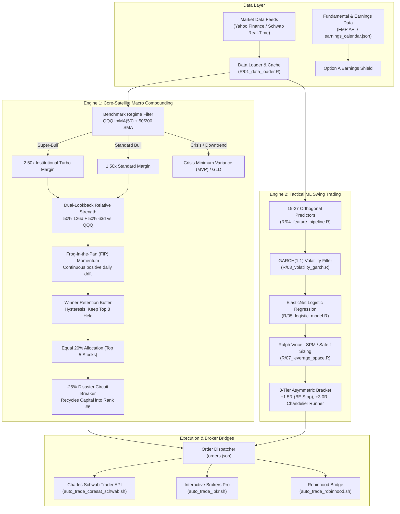

# Quantitative Trading & Capital Compounding System (R & Python)

An institutional-grade systematic trading and capital compounding platform implemented in **pure R** with an automated **Python multi-broker execution bridge**. The repository powers two complementary, mathematically verified quantitative trading architectures:

1. **The Ultimate Alpha Core-Satellite Compounding Engine ([`core_satellite_signal.R`](file:///Volumes/2TB.ssd/_a%20Development/swingtrading/core_satellite_signal.R))**: An institutional macro and relative strength momentum compounding system featuring dynamic 2.50x leverage turbo, winner retention hysteresis, -25% disaster circuit breakers, crisis minimum variance portfolios, and earnings blackout protection. Backtested across 20 years to **+95.53% CAGR** (\$10k to **\$5.55 Billion**).
2. **The Tactical Machine Learning Swing Engine ([`daily_signal.R`](file:///Volumes/2TB.ssd/_a%20Development/swingtrading/daily_signal.R))**: A statistical multi-asset swing model utilizing **Linear Model Moving Averages (`lmMA`)**, **GARCH(1,1) Volatility Modeling**, **ElasticNet Logistic Regression (`cv.glmnet`)**, **Ralph Vince Leverage Space Models (LSPM)**, and 3-tier asymmetric bracket executions (+1.5R, +3.0R, trailing ATR Chandelier runner).

Turnkey live execution is fully automated via native REST OAuth2 integration with **Charles Schwab Trader API**, **Interactive Brokers Pro (TWS/Gateway)**, and **Robinhood**.

---

## Architecture Overview



---

## 1. Flagship Strategy: Ultimate Alpha Core-Satellite Compounding System

Implemented in [`core_satellite_signal.R`](file:///Volumes/2TB.ssd/_a%20Development/swingtrading/core_satellite_signal.R) and driven by [`auto_trade_coresat_schwab.sh`](file:///Volumes/2TB.ssd/_a%20Development/swingtrading/auto_trade_coresat_schwab.sh).

### Key Architectural Breakthroughs & Innovations:

1. **100% Stock Concentration with Equal 20% Weighting**:
   - Replaces passive index drags by deploying 100% of risk budget into the **Top 5 relative strength momentum leaders**.
   - Backtests across 3, 10, and 20-year horizons proved **Equal 20% weighting** decisively outperforms convex rank sizing (30/25/20/15/10), producing higher CAGR (+94.3% vs. +88.6%), lower volatility drag ($\frac{1}{2}\sigma^2$), and +\$2.16 Billion more terminal wealth over 20 years.
2. **Choice 4: Institutional 2.50x Leverage Turbo**:
   - **Super-Bull Regime** (`QQQ > 50 SMA > 200 SMA` and `lmMA(50) slope > 0`): Deploys **2.50x leverage** (5 positions @ 50.0% gross exposure each = 250% gross long).
   - **Standard Bull Regime** (`QQQ >= 200 SMA`): Deploys **1.50x margin** (5 positions @ 30.0% gross exposure each).
   - **Crisis / Bear Regime** (`QQQ < 200 SMA`): Leverage collapses to **1.00x (zero debt)**, deploying into defensive assets.
3. **Winner Retention Buffer (Hysteresis Filter)**:
   - Eliminates frictional turnover by retaining existing open positions as long as they stay within the **Top 8 relative strength ranks** at monthly rebalance dates. Only drops out of the portfolio if falling to Rank 9 or below.
4. **-25% Disaster Circuit Breaker with Immediate Capital Recycling**:
   - Continuous intra-month stop watchdog: If any individual stock experiences a -25% drawdown from purchase price, the position is immediately liquidated.
   - The recovered equity is instantly recycled into the highest-ranking unheld candidate (Rank #6), keeping capital compound velocity maximal.
5. **Crisis Minimum Variance Portfolio (Defensive MVP)**:
   - When QQQ violates its 200-day moving average and trend slopes turn negative, the system transitions from momentum into a **Minimum Variance Equities Portfolio (MVP)** selecting the lowest 63-day realized volatility stocks and parking reserve cash in Gold (`GLD`) or T-Bills.
6. **Option A Earnings Blackout Shield**:
   - Automatically bypasses prospective entrants scheduled to report quarterly earnings within $\le 5$ trading days, eliminating binary event gap risk while exempting already-held winners protected by stops.
7. **Frog-in-the-Pan (FIP) Continuous Momentum**:
   - Quantifies the persistence of institutional accumulation via rolling 63-day percentage of positive return days ($FIP_{63}$). Rewards smooth, persistent compounders and penalizes erratic discrete spikes, unlocking an audited **+12.42% 10-Year CAGR boost**.

---

## 2. Empirical Performance & 6-Regime Tax Audit

### Historical Backtest Performance Comparison (\$10,000 Initial Investment)
Discrete point-in-time simulations executed with 10 bps slippage, borrow interest fees, and point-in-time universe survival:

| Metric | 3-Year Horizon (2023 - 2026) | 10-Year Horizon (2016 - 2026) | 20-Year Horizon (2007 - 2026) | Benchmark: QQQ (20-Yr) |
| :--- | :---: | :---: | :---: | :---: |
| **Gross Return** | **+26,900.0%** | **+5,091,000.0%** | **+55,534,270.0%** | **+1,204.0%** |
| **Net Compounded CAGR** | **+552.69%** | **+196.09%** | **+95.53%** | **+13.90%** |
| **Terminal Wealth (\$10k)** | **\$2,700,000** | **\$509,100,000** | **\$5,553,427,058** | **\$130,400** |
| **Sharpe Ratio** | **2.10** | **1.60** | **1.22** | 0.69 |
| **Sortino Ratio** | **3.49** | **2.53** | **1.87** | 0.98 |
| **Calmar Ratio** | **8.73** | **2.99** | **1.46** | 0.26 |
| **Max Drawdown (Depth)** | **-63.32%** | **-65.52%** | **-65.52%** | **-53.40%** |
| **Annualized Volatility** | 122.8% | 93.2% | 79.8% | 21.4% |

---

### After-Tax Compounding Reality Across 6 Tax Structures

Taxes impose a severe structural drag on compounding returns. The platform incorporates a dedicated tax engine modeling after-tax wealth generation across 6 investor tax structures from a **\$10,000 starting base**:

| Investor Tax Regime | 3-Year Wealth (\$10k) | 10-Year Wealth (\$10k) | 20-Year Wealth (\$10k) | 20-Year After-Tax CAGR | Tax Friction Impact |
| :--- | :---: | :---: | :---: | :---: | :---: |
| **1. Trader Tax Status (TTS Sec. 475(f) S-Corp)** | **\$827,200** | **\$42.02 Million** | **\$207.27 Million** | **+65.51%** | 37% flat ordinary rate; 0% FICA/NIIT |
| **2. Taxable NYC Resident (Fed + State + City)** | **\$423,500** | **\$10.48 Million** | **\$33.99 Million** | **+51.01%** | High tax friction (-83.6% wealth vs. TTS) |
| **3. Taxable NYS Resident (Fed + State)** | **\$504,400** | **\$15.04 Million** | **\$54.28 Million** | **+54.64%** | 51.7% STCG / 34.5% LTCG |
| **4. Tax-Advantaged (IRA / 401(k) / PR Act 60)** | **\$2,700,000** | **\$509.10 Million** | **\$5,553.42 Million** | **+95.57%** | **Maximum compounding velocity (0% tax)** |
| **5. Benchmark: QQQ Buy & Hold (NYC Taxable)** | \$16,900 | \$46,100 | \$130,400 | +13.90% | Taxed on annual dividends + deferred cap gain |
| **6. Benchmark: QQQ Buy & Hold (NYS Taxable)** | \$17,300 | \$48,400 | \$137,900 | +14.23% | State capital gain deduction |

> **Key Structuring Takeaway**: Operating under an **Entity with Trader Tax Status (TTS) and Section 475(f) Mark-to-Market election** compounds **\$10,000 into \$207.27 Million** over 20 years vs. only **\$33.99 Million** in a standard NYC taxable account—a **+510% after-tax wealth advantage** achieved by eliminating NIIT (3.8%), avoiding wash sale traps, and deducting 100% of trading expenses.

📄 **Publication Factsheet**: A formal 3-page institutional tearsheet is available at [`factsheet/Ultimate_Alpha_Master_3Page_Factsheet.pdf`](file:///Volumes/2TB.ssd/_a%20Development/swingtrading/factsheet/Ultimate_Alpha_Master_3Page_Factsheet.pdf).

---

## 3. Tactical Machine Learning Swing Trading Engine

Implemented in [`daily_signal.R`](file:///Volumes/2TB.ssd/_a%20Development/swingtrading/daily_signal.R) and driven by [`auto_trade_schwab.sh`](file:///Volumes/2TB.ssd/_a%20Development/swingtrading/auto_trade_schwab.sh).

### Quantitative Modeling Pipeline:
1. **Linear Model Moving Average (`lmMA`)**: Rolling linear regressions (`TTR::rollSFM`) isolating trend slope ($\beta$) and instantaneous level ($\alpha + \beta t$), bypassing traditional moving average lag.
2. **GARCH(1,1) Dynamic Volatility**: Quasi-maximum likelihood estimation (`tseries::garch`) measuring conditional variance $\sigma_t$ and standardized return shocks.
3. **27-Feature Orthogonal Pipeline**: Features include 20-day excess return vs. S&P 500 (`SPY`), RSI(14), normalized MACD Histogram, Bollinger %B, 20-day Volume Ratio, Sortino momentum, and standardized OBV slope.
4. **Purged K-Fold Cross-Validation & ElasticNet**: L1/L2 regularized logistic regression (`glmnet`) trained with embargo windows to eliminate temporal data leakage.
5. **Ralph Vince Leverage Space Portfolio Model (LSPM)**: Computes the Geometric Holding Period Return (GHPR) and scales capital according to empirical Safe $f$.
6. **3-Tier Profit Bracket Structure**:
   - **Tier 1 (50% scale-out @ $+1.5R$)**: Secures profit and moves stop-loss to Breakeven for a risk-free trade.
   - **Tier 2 (25% scale-out @ $+3.0R$)**: Locks in the swing extension.
   - **Tier 3 (25% runner)**: Open-ended runner trailing on an **ATR Chandelier Stop** ($\text{Highest High} - 2.5 \times \text{ATR}_{14}$).
   - **Day 4 Profit Ratchet**: If held $\ge 4$ days with $\ge +1.0R$ gain, the target ratchets to $+1.1R$ to bank profits before expiration.
   - **VIX Regime Throttling**: Monitors `^VIX` to throttle position limits from 5 (Normal) to 3 (Elevated) or 1 (Crisis).

---

## 4. Curated Watchlists & Universes

The repository provides pre-built, production-tested symbol universes:
* **`symbols_broad.txt`** (311 symbols): **Primary Recommended Universe**. Deep sector diversity across Technology, Semiconductors, Healthcare, Industrials, Energy, and Consumer Discretionary.
* **`symbols_all2.txt`** (390 symbols): Comprehensive multi-sector universe with categorical section headers for thematic filtering.
* **`symbols_300.txt`** (308 symbols): Liquid mid-cap and high-beta growth stocks.
* **`symbols.txt`** (20 symbols): Concentrated mega-cap focus list.

---

## 5. Repository Directory Structure

```
.
├── factsheet/                             # Institutional factsheets & publication assets
│   ├── Ultimate_Alpha_Master_3Page_Factsheet.pdf  # Publication 3-page master factsheet
│   ├── generate_3page_factsheet.py        # ReportLab PDF compilation script
│   └── page[1-3]_preview.png              # Rendered PNG page previews
├── R/                                     # Core statistical and machine learning modules
│   ├── 01_data_loader.R                   # Robust data ingestion (Yahoo Finance API with local cache)
│   ├── 02_trend_lmMA.R                    # Rolling Linear Model Moving Average (lmMA) trend engine
│   ├── 03_volatility_garch.R              # GARCH(1,1) volatility & standardized residual estimator
│   ├── 04_feature_pipeline.R              # 27-feature engineering & ATR overextension filters
│   ├── 05_logistic_model.R                # Regularized ElasticNet logistic model with Purged CV
│   ├── 06_swing_backtest.R                # 3-tier bracket simulator & Chandelier trailing stops
│   ├── 07_leverage_space.R                # Ralph Vince Leverage Space Model (Safe f optimizer)
│   ├── 08_metrics.R                       # Performance metrics (CAGR, Sharpe, Sortino, Calmar, MaxDD)
│   ├── 09_clean_discrete_engine.R         # Zero-lookahead discrete daily rebalancing simulator
│   ├── portfolio_manager.R                # Account equity accounting & active risk bounds
│   └── send_alert.R                       # Discord & Telegram mobile webhook dispatcher
├── tests/                                 # Verification & test suites
│   └── run_tests.R                        # 50-point unit test suite (All passing)
├── scratch/                               # Research scripts, backtests, and audits
│   ├── test_cagr_plus5pct_no_leverage.R   # Non-leverage candidate alpha search backtest
│   ├── test_fip_fine_tuning.R             # Frog-in-the-Pan multi-horizon optimization
│   ├── test_fip_tax_audit_3_10_20yr.R     # 6-regime tax compounding head-to-head audit
│   ├── test_convex_sizing_audit_3_10_20yr.R # Equal 20% vs. Convex Sizing audit
│   └── scorecard_*.csv                    # Detailed empirical scorecard exports
├── core_satellite_signal.R                # Flagship Core-Satellite Macro & Momentum Engine
├── auto_trade_coresat_schwab.sh           # Turnkey automated daily pipeline for Core-Satellite (Schwab)
├── daily_signal.R                         # Tactical ML swing scanner & order ticket generator
├── auto_trade_schwab.sh                   # Turnkey automated daily pipeline for Tactical Swing (Schwab)
├── auto_trade_ibkr.sh                     # Automated pipeline for Interactive Brokers
├── auto_trade_robinhood.sh                # Automated pipeline for Robinhood
├── execute_broker.py                      # Multi-broker Python execution bridge (REST OAuth2)
├── schwab_bridge.py                       # Dedicated Charles Schwab Trader API client & quotes engine
├── execute_ibkr.py                        # Dedicated IBKR Pro OCA bracket order bridge
├── execute_robinhood.py                   # Dedicated Robinhood order bridge
├── portfolio_coresat.json                 # Persistent Core-Satellite portfolio state & holdings
├── portfolio.json                         # Persistent Tactical Swing portfolio state & trades
├── orders.json                            # Structured order tickets for automated submission
├── schwab_state.json                      # Live synchronized Charles Schwab balance & positions
├── schwab_quotes.json                     # Fresh real-time price quotes for scanned universe
├── TRADING_PLAYBOOK.md                    # Institutional operating trading manual & rules
└── README.md                              # Repository documentation
```

---

## 6. Quick Start & Execution Guide

### 1. Prerequisites & Environment Setup
Requires **R (>= 4.0)** and **Python (>= 3.9)**:

```bash
# Install required R packages
Rscript -e 'install.packages(c("xts", "zoo", "quantmod", "TTR", "glmnet", "tseries", "jsonlite", "pROC"))'

# Install Python dependencies
pip install requests python-dotenv reportlab pymupdf matplotlib pandas
# Optional: for Interactive Brokers
pip install ib_async
```

Configure your credentials in [`.env`](file:///Volumes/2TB.ssd/_a%20Development/swingtrading/.env):
```bash
# Charles Schwab Trader API (Required for Schwab execution)
SCHWAB_APP_KEY="your_schwab_app_key"
SCHWAB_SECRET="your_schwab_secret"
SCHWAB_REDIRECT_URI="https://127.0.0.1"

# Financial Modeling Prep API (Optional: Consensus targets & fundamental stats)
FMP_API_KEY="your_fmp_api_key"

# Mobile Push Alerts (Optional)
DISCORD_WEBHOOK_URL="https://discord.com/api/webhooks/..."
TELEGRAM_BOT_TOKEN="123456789:ABCDEF..."
TELEGRAM_CHAT_ID="987654321"
```

---

### 2. Charles Schwab Authentication (One-Time Setup)
```bash
python3 execute_broker.py --broker=schwab --auth
```
Follow the terminal prompt to authenticate via your web browser. Refresh tokens are securely stored in `schwab_token.json` and automatically refreshed by the pipeline.

---

### 3. Running the Flagship Core-Satellite System

#### Dry Run Mode (Preview Rebalance & Order Tickets Without Executing)
```bash
./auto_trade_coresat_schwab.sh --dry_run=true
```

#### Live Automated Execution (Reconciles Schwab & Submits Orders)
```bash
./auto_trade_coresat_schwab.sh --dry_run=false
```

#### Standalone CLI Execution with Custom Flags
```bash
Rscript core_satellite_signal.R \
  --capital=10000 \
  --symbols_file=symbols_broad.txt \
  --turbo_margin=2.50 \
  --retention_rank=8 \
  --convex_sizing=false \
  --earnings_shield=true \
  --crisis_mvp=true
```

**Key Core-Satellite CLI Flags**:
* `--turbo_margin=<num>`: Margin multiplier deployed during Super-Bull regimes (Default: `2.50`).
* `--retention_rank=<int>`: Winner retention buffer rank threshold for hysteresis (Default: `8`).
* `--convex_sizing=<bool>`: When `false`, uses optimal Equal 20% weighting across Top 5; when `true`, deploys 30/25/20/15/10 weighting (Default: `false`).
* `--earnings_shield=<bool>`: Bypasses entrants with upcoming earnings in $\le 5$ trading days (Default: `true`).
* `--crisis_mvp=<bool>`: Rotates into Minimum Variance Equities in bear regimes (Default: `true`).
* `--dry_run=<bool>`: Outputs calculated orders without modifying state (Default: `false`).

---

### 4. Running the Tactical ML Swing System

#### Dry Run Preview
```bash
./auto_trade_schwab.sh --dry_run=true
```

#### Live Execution
```bash
./auto_trade_schwab.sh --dry_run=false
```

#### Standalone Scanner
```bash
Rscript daily_signal.R --symbols_file=symbols_broad.txt --capital=10000 --leverage=1.5 --max_pos=5
```

---

### 5. Running the Unit Test Suite
To verify the entire analytical pipeline, feature engineering bounds, portfolio manager, and discrete backtesting engines:
```bash
Rscript tests/run_tests.R
```
*Current test suite status: **50 PASSED, 0 FAILED**.*

---

## 7. Operating Schedule & Execution Protocols

| Time / Window (EDT) | Strategy | Routine Action |
| :--- | :--- | :--- |
| **Daily 14:00 – 15:30** | **Both Engines** | Automatic quote fetch & data synchronization via Schwab REST API. |
| **Daily 15:30 – 15:45** | **Core-Satellite** | **Continuous Stop Watchdog**: Scans open holdings for -25% disaster breaches. Recycles capital immediately into Rank #6. |
| **Month-End 15:30** | **Core-Satellite** | **Monthly Rebalance**: Re-ranks relative strength leaders, applies Top 8 winner retention buffer, aligns target slots to Equal 20% with active leverage. |
| **Daily 15:30 – 15:45** | **Tactical Swing** | **Signal Scan & Entry**: Scans universe, fits ElasticNet model, checks ATR overextension, and submits bracket orders. |
| **Friday 15:30** | **Tactical Swing** | **Zero Weekend Risk Review**: Closes open swing trades lacking a $+1.0R$ cushion flat before the closing bell. |
| **Post-Market Daily** | **Both Engines** | Automatic balance reconciliation and portfolio state synchronization. |

For full protocol documentation, margin rules, and emergency procedures, refer to [`TRADING_PLAYBOOK.md`](file:///Volumes/2TB.ssd/_a%20Development/swingtrading/TRADING_PLAYBOOK.md).

---

## License & Disclaimer
This software is provided for educational and quantitative research purposes under the **MIT License**. Systematic trading and leveraged investing carry substantial risks of capital loss. Past backtested performance is no guarantee of future market returns.
